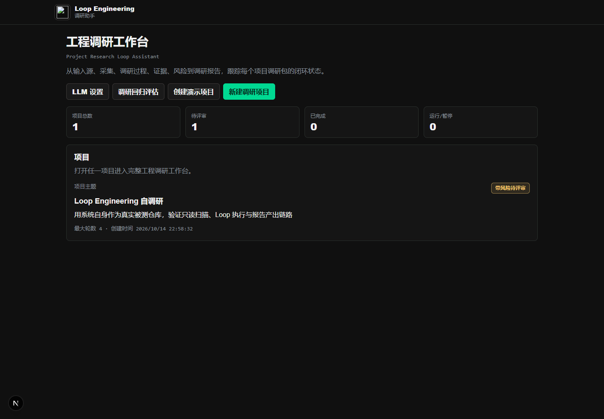
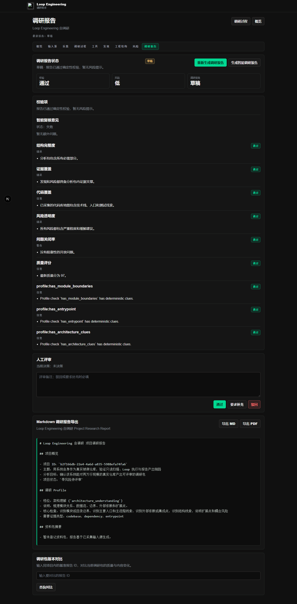
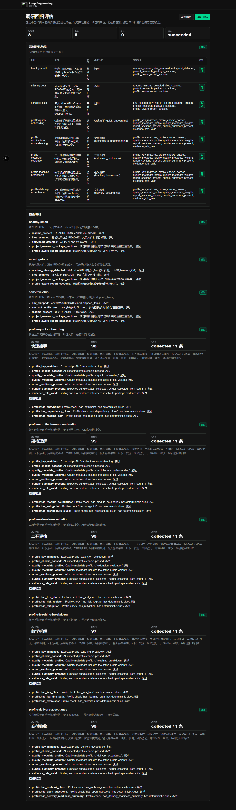
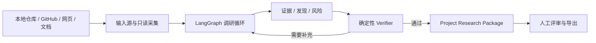

# Codebase Research Loop

把陌生代码库转化为可审阅、可追溯的工程接手指南。

输入本地仓库、GitHub 仓库、网页或 PDF，系统通过 LangGraph 调研循环完成资料采集、代码扫描、架构分析和证据引用，再通过确定性校验生成 Project Research Package。

[81 秒演示](docs/assets/codebase-research-demo.webm) · [快速开始](#快速开始) · [能力边界](#能力边界) · [验证记录](docs/verification.md)



<details>
<summary>查看调研报告和回归评估截图</summary>





</details>

> 只读调研：不修改目标仓库，不执行目标项目脚本，不自动创建 commit、issue 或 PR。LLM 是增强项，结论必须经过证据引用和确定性 verifier。

## 为什么不是直接让模型总结代码

代码库接手的难点不是生成一段摘要，而是让结论可检查、任务可恢复、结果可复用。Codebase Research Loop 把调研过程拆成明确节点，并持续保存输入源、采集记录、运行事件、证据、发现、风险和报告版本。

- 证据可追踪：报告中的发现需要引用采集到的文件和资料。
- 运行可恢复：LangGraph checkpoint 和后台 worker 支持长任务恢复。
- 质量可验证：LLM 输出必须经过结构解析、证据校验和确定性规则。
- 结果可评审：调研包支持人工通过、驳回和继续补充。

## 工作方式



调研包包含：

- Executive Brief、Research Profile 和 Source Bundle Summary。
- Engineering Onboarding Guide、Reading Path 和 Source Inventory。
- Codebase Map、Architecture Map、Runbook 和 Findings。
- Risk Register、Open Questions 和 Evidence Index。
- Verifier Result、Run Timeline、LLM Call Summary 和 Report Snapshot。

## 技术架构

- Next.js 提供中文优先的工程调研工作台。
- FastAPI 提供 REST / SSE API。
- LangGraph `StateGraph` 编排 9 个可恢复调研节点。
- 后台 worker 执行长任务，HTTP 请求只负责排队。
- MySQL 保存业务数据、运行事件和 graph checkpoint。
- OpenAI-compatible provider 接入 DeepSeek、Qwen/DashScope 或自部署 vLLM。
- 确定性 verifier 检查报告结构、证据引用、代码覆盖和风险缓解。

## 本地依赖

- uv 0.11+
- Python 3.11+
- Node.js 20+
- MySQL 8+

## 快速开始

### 1. 安装配置

在仓库根目录复制环境变量文件：

```powershell
Copy-Item .env.example .env
```

至少修改数据库连接和 LLM 配置。API key 只放在本机 `.env`，不要提交到 Git。

```env
DATABASE_URL=mysql+pymysql://root:<local-password>@localhost:3306/loop_engineering
WORKSPACE_ROOT=D:/loop-workspace/projects
NEXT_PUBLIC_API_BASE_URL=http://localhost:8000

LLM_PROVIDER=deepseek
LLM_API_KEY=<your-api-key>
LLM_BASE_URL=https://api.deepseek.com
LLM_MODEL=deepseek-chat
```

<details>
<summary>查看其他 LLM provider 配置</summary>

```env
# Qwen / DashScope OpenAI-compatible mode
LLM_PROVIDER=qwen
LLM_BASE_URL=https://dashscope.aliyuncs.com/compatible-mode/v1
LLM_MODEL=qwen-plus
LLM_API_KEY_REQUIRED=true

# Self-hosted vLLM OpenAI-compatible server
LLM_PROVIDER=vllm
LLM_BASE_URL=http://127.0.0.1:8001/v1
LLM_MODEL=<served-model-name>
LLM_API_KEY_REQUIRED=false
```

</details>

### 2. 创建数据库

```powershell
mysql -uroot -p -e "CREATE DATABASE IF NOT EXISTS loop_engineering CHARACTER SET utf8mb4 COLLATE utf8mb4_unicode_ci;"
```

### 3. 启动后端 API

```powershell
Set-Location services/api
uv python install 3.11
uv sync --extra dev
uv run alembic upgrade head
uv run python -m uvicorn app.main:app --reload --host 127.0.0.1 --port 8000
```

健康检查：

```powershell
Invoke-RestMethod http://127.0.0.1:8000/health
```

### 4. 启动后台 Worker

另开一个 PowerShell 终端：

```powershell
Set-Location services/api
$env:PYTHONPATH='.'
uv run python -m app.workers.worker_service --queue default --poll-interval 2
```

Worker 使用 lease 和 heartbeat 防止重复领取任务，并把运行过程写入 durable run events。

### 5. 启动前端

另开一个终端，在仓库根目录执行：

```powershell
npm --prefix apps/web install
npm --prefix apps/web run dev -- --hostname 127.0.0.1 --port 3000
```

打开 `http://127.0.0.1:3000/projects`。

## 推荐体验路径

1. 打开 `/projects/new` 创建调研项目，并选择“快速接手”“架构理解”或“教学拆解”等档位。
2. 添加本地目录、公开 GitHub URL、网页或 Markdown/PDF 资料。
3. 启动调研 Loop，观察后台任务、运行事件和 checkpoint 状态。
4. 审阅发现、风险和证据引用，生成 Project Research Package。
5. 通过、驳回或要求补充报告。
6. 在 `/evaluations` 运行结构回归评估。

## 验证

后端测试：

```powershell
Set-Location services/api
uv run --extra dev python -m pytest tests -q
```

前端构建：

```powershell
npm --prefix apps/web run build
```

数据库迁移状态：

```powershell
Set-Location services/api
uv run python -m alembic -c alembic.ini current
```

最近一次完整验证记录了 268 个通过用例、1 个跳过用例、14 个 Alembic 迁移和 27 张 SQLAlchemy 业务表。详细步骤见 [验证记录](docs/verification.md)。

## 能力边界

本项目只做只读工程调研，不修改被分析代码，不执行被分析项目脚本，不创建 commit、issue 或 PR。

当前 `/evaluations` 包含 8 个确定性用例，其中 3 个是扫描回归，5 个是调研档位 fixture。它们验证结构、证据引用和报告章节是否稳定，不代表真实仓库上的人工质量评测。

LLM 分析或复核失败时，系统会回退到确定性分析链路。当前最大的验证缺口是缺少公开、真实、多仓库的人工质量评测集。

## 主要页面

```text
/projects
/projects/new
/projects/:id
/projects/:id/sources
/projects/:id/inventory
/projects/:id/run
/projects/:id/findings
/projects/:id/codebase
/projects/:id/risks
/projects/:id/report
/settings/llm
/evaluations
```

## 文档

- 演示脚本：[docs/demo-script.md](docs/demo-script.md)
- 设计追问：[docs/interview-qa.md](docs/interview-qa.md)
- 验证记录：[docs/verification.md](docs/verification.md)
